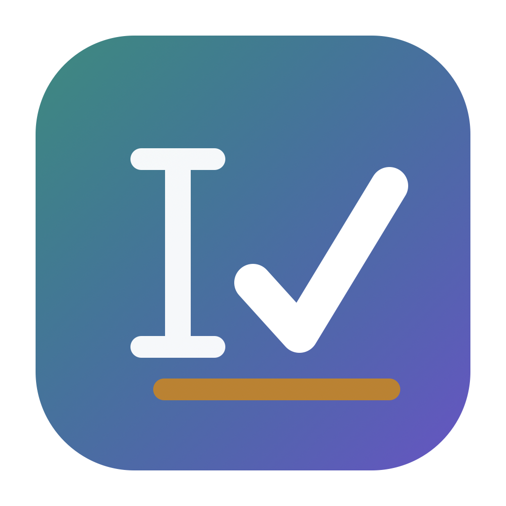

# Corrector — documentation

The full manual: every command, every option, and the reasoning behind the
architecture. For what Corrector is and how to install it, start at the
[README](README.md).



---

## Quick start

### The app

```bash
./Tools/make-app.sh              # builds dist/Corrector.app
open dist/Corrector.app
```

A real macOS bundle: editor on the left with suggestions underlined in their
category colour, cards and scores on the right, a menu-bar item mirroring the
live score. Your document is restored on next launch.

### The CLI

```bash
swift build
swift test                       # 257 tests
swift run corrector demo         # architecture walkthrough
swift run corrector check memo --cards
```

The binary lands at `.build/debug/corrector` (or `-c release`), and is also
shipped inside the bundle as `Corrector.app/Contents/MacOS/corrector-cli`.

> **Why a window and not only a menu-bar item.** Corrector holds a document of
> its own, and a document needs somewhere to be read. The menu-bar item stays
> alongside it, mirroring the live score, because the window is usually behind
> whatever is being written in.

## Commands

```
corrector check  <file|-> [options]    Check a document and print suggestions
corrector fix    <file|-> [options]    Apply every suggestion, print the result
corrector stats  <file|-> [options]    Readability and length statistics only
corrector demo                         Walk through the architecture live
corrector samples                      List bundled sample documents
```

## Correcting text in other apps

### Anywhere, with a shortcut

**⌥⌘C** corrects the selection in whatever application is frontmost. It acts
only when you press the key; nothing is read otherwise.

It takes the better of two roads, and falls back to the other:

1. **Through the Accessibility API.** Corrector reads the selected text from
   the focused field and writes the correction straight back. The
   application's own undo records the change, surrounding formatting survives,
   and your clipboard is never touched. This works in Cocoa applications and
   in the Electron ones that have switched their accessibility support on.
2. **Through the clipboard.** If the field will not answer, Corrector
   synthesises ⌘C, corrects what lands on the clipboard, pastes the result
   back and restores what you had copied. Cruder — it borrows your clipboard,
   flattens rich text and leaves one undo step covering everything — but it
   works wherever copy and paste do.

Only the clipboard's *text* is preserved and restored on that second road.
Restoring every representation of an arbitrary pasteboard is not reliably
possible, and quietly losing a copied image would be worse than saying so here.

> **This needs Accessibility permission**, either way. Registering the shortcut
> does not, but reading a field does, and so does *posting* the synthetic ⌘C
> and ⌘V — macOS silently ignores synthetic keystrokes from untrusted
> applications. Grant it in System Settings → Privacy & Security →
> Accessibility, then restart Corrector. The app asks the first time you use
> the shortcut, and says the permission is missing rather than failing quietly.

#### What it will and will not change

The shortcut applies **spelling and punctuation only**. Those rules are
decidable: a word is in the dictionary or it is not, French takes a narrow
no-break space before a semicolon or it does not.

Grammar and style are deliberately excluded here. They are heuristics over a
sentence the engine cannot fully parse, and they are sometimes wrong — and this
is the one path that rewrites text you are not looking at, in a document
Corrector cannot show you. The right-click menu below applies the wider set,
because there the selection is in front of you.

Two further rules are skipped whenever a *selection* is corrected, by either
route: adding a missing full stop, and capitalising the first word. A selection
is a fragment — it starts and ends wherever you released the mouse — so both
would be wrong about it. They still apply in Corrector's own window, where the
text really is a whole document.

#### Where it refuses to fire

- **Password fields**, always. Checked by both accessibility role and subrole,
  since the two differ between frameworks.
- **Terminals and password managers**, by default. At a shell prompt ⌘V
  inserts at the cursor instead of replacing the selection, so a "correction"
  would append to your command line — and a newline in it would run the
  command.

The list lives in the `quick.blockedApplications` preference. A field whose
role the application does not expose at all is *allowed*: refusing everywhere
the API is silent would disable the feature in most of the applications it
exists to serve.

### From the right-click menu

Corrector registers two macOS **Services**. Select text anywhere, right-click →
**Services**:

| Menu item                 | What it does                                               |
| ------------------------- | ---------------------------------------------------------- |
| **Corriger la sélection** | corrects the text and replaces the selection in place      |
| **Ouvrir dans Corrector** | sends the selection to the window for review, card by card |

This needs **no Accessibility permission**. The system hands over the selection,
once, because you asked — rather than the app reading every editable field in
every application. Declaring `NSReturnTypes` is what lets the first one
substitute its result for your selection.

The two differ on purpose. "Corriger la sélection" applies only objective
fixes — spelling, grammar, punctuation, typography — and leaves style alone:
nobody right-clicking to fix a typo has asked for their intensifiers to be
deleted. Clarity and engagement suggestions are offered in the window instead,
where you can take them one at a time.

Both detect the language of the selection independently of whatever the window
is set to.

**Limits.** Native Cocoa apps (Mail, Notes, TextEdit, Pages) work well,
in-place replacement included. Electron and WebView apps (Teams, Slack, VS Code)
generally accept the text; replacement is less reliable and varies per app. In
browsers it works in editable fields, best in Safari. If the menu items do not
appear, launch the app once and check System Settings → Keyboard → Keyboard
Shortcuts → Services; `/System/Library/CoreServices/pbs -flush` forces the
system to re-read them.

> Services cost no permission and no background process, which is why they are
> the first road into other applications rather than the last. The price is that
> nothing happens until you invoke one: there is no live underlining here.

## Getting text out

The toolbar's copy button takes the selection, or the whole document when
nothing is selected. Also ⌘⇧C, and in the menu-bar item.

## Languages

Corrector checks **English and French**, and its interface speaks both.

```bash
corrector check note-fr                      # language detected from the text
corrector check note-fr --language french    # or stated outright
corrector check memo --dialect british
```

The two rule sets are genuinely separate, not translations of each other.
French gets checks English has no equivalent for — elision (`le ami` → `l'ami`),
the conditional after « si », guillemets, the typographic apostrophe — and most
visibly the **non-breaking space before `;` `!` `?` `:`** that French typography
requires and English forbids. The same input is an error in one language and
correct in the other, which is why `CheckPlugin` declares the languages it
understands and the engine skips the rest.

`--dialect auto` (the default) picks the language from the text's function
words and accents. In the app, the toolbar has a dialect picker grouped by
language and a separate **Interface** picker; the status bar names the language
the engine actually resolved to, so `auto` is never opaque. Both choices, and
your enabled checks, persist across relaunches.

| Option           | Effect                                                                                                                                                             |
| ---------------- | ------------------------------------------------------------------------------------------------------------------------------------------------------------------ |
| `--json`         | machine-readable output                                                                                                                                            |
| `--only <c,…>`   | `spelling,grammar,punctuation,clarity,engagement,styleGuide,inclusivity`                                                                                           |
| `--language <l>` | `english · french`                                                                                                                                                 |
| `--dialect <d>`  | EN: `american · british · canadian · australian · indian`<br>FR: `french · canadianFrench · belgianFrench · swissFrench`<br>`auto` (default) detects from the text |
| `--transient`    | treat the input as an ephemeral field (correctness checks only)                                                                                                    |
| `--cards`        | expanded cards instead of the compact list                                                                                                                         |
| `--ui <l>`       | interface language: `english · french` (defaults to the system's)                                                                                                  |
| `--no-color`     | disable ANSI colour (also honours `NO_COLOR`)                                                                                                                      |

Four sample documents ship with the binary — `memo`, `release-notes`, `clean`,
`emoji` — and resolve by name: `corrector check memo`.

## What it looks like

```
$ corrector check memo

sample:memo  rev 1
══════════════════════════════════════════════════════════════════
teh quarterly update

Due to the fact that we recieve a large number of requests each week , the
support team was overwhelmed in October…
──────────────────────────────────────────────────────────────────
Score  ██████░░░░░░░░░░░░░░  32/100   tone: detached

  ! Correctness █░░░░░░░░░░░░░░░░░░░   3   11 issues
  ~ Clarity     ████░░░░░░░░░░░░░░░░  20    7 issues
  + Engagement  █████████████████░░░  85    1 issue
  = Style guide ██████████████████░░  88    1 issue
──────────────────────────────────────────────────────────────────
21 suggestions

 1  ! Misspelled word           → the        [0..<3]
 2  ! Misspelled word           → receive    [46..<53]
 3  ! Space before punctuation  → (delete)   [90..<91]
12  ~ Wordy phrase              → because    [22..<42]
…
```

## Architecture

```
corrector (CLI)            terminal rendering of underlines, cards, scores
    │
CorrectorSession           session FSM · protocol messages · capability
    │                      negotiation · revision rebasing
CorrectorEngine            plugin registry · 7 check plugins · scoring
    │
CorrectorCore              Alert · CardLayout · Scores · TextStats ·
    │                      EditSession · AlertStore · DocumentStore · Theme
CorrectorDelta             Quill-Delta operational transform, UTF-16 offsets
```

Every layer below `CorrectorApp` builds and runs without a window, which is why
the terminal and the app share all of it and why a rule can be written and
asserted on before any view exists.

### Three decisions worth knowing

**Offsets are UTF-16 code units, everywhere.** `NSTextView` addresses text with
`NSRange` and the Accessibility API answers in the same unit, so UTF-16 is what
every surface Corrector talks to already speaks. Anything else mis-places
underlines the moment a document contains an emoji. `corrector check emoji`
demonstrates this.

**Suggestions are rebased, not recomputed.** A suggestion is stamped with the
revision it was computed against. If the user has typed since, its span is
transformed onto the current revision through the intervening changesets rather
than thrown away — which is what stops cards flickering and jumping mid-sentence.
`AlertStore.rebase(through:newRevision:)` and `Alert.rebased(through:newRevision:)`.

**Checks are plugins behind a negotiated feature set.** A session advertises
what it is willing to run and is granted a subset of it, once, rather than every
call site asking whether a category is on: `--only` narrows the request,
`--transient` marks an ephemeral field, which gets correctness checks only.
Nobody wants tone advice on a search box.

## What Corrector deliberately does not do

**It does not watch you type.** There is no event tap, no polling, and no
standing subscription to the contents of other applications. ⌥⌘C reads
`AXFocusedUIElement` and `AXSelectedText` **once, from one element, in response
to a keystroke you pressed** — to decide whether the field is safe to touch, and
to replace what you selected. It reads no field you did not select and runs no
code between keystrokes. A question asked once and answered once, not a
microphone left open.

**It refuses where it should.** Password fields are never read: `AXSecureTextField`
is checked as both a role and a subrole, because toolkits disagree about which
one it is. A short list of applications is excluded outright — keychains,
password managers, terminals. A shell prompt treats a pasted newline as a
command, and that is not a risk worth running for a typo.

**It has no server and no account.** Every suggestion is computed on the
machine, which is also why the rule set is deliberately modest rather than
boundless: seven plugins per language covering spelling, grammar,
punctuation/typography, clarity, engagement, style and inclusive language. They
are offline, inspectable and testable, and they will never surprise you with a
different answer tomorrow.

## Layout

```
.
├── Package.swift
├── README.md · DOCUMENTATION.md · CHANGELOG.md
├── Assets/            generated icon, plus the README screenshots
├── Tools/make-icon.swift
├── Sources/
│   ├── CorrectorDelta/    UTF16 · Op · OpIterator · Delta · Diff
│   ├── CorrectorCore/     Alert · CardLayout · Scores · TextStats ·
│   │                      Tokenizer · EditSession · AlertStore ·
│   │                      DocumentStore · Theme
│   ├── CorrectorEngine/   CheckPlugin · CheckEngine · LanguageDetector
│   │                      7 English plugins + 7 French plugins
│   ├── CorrectorSession/  Messages · Session
│   ├── CorrectorAppCore/  the app layer that is not a view, so it can be
│   │                      tested: SelectionCorrector · TargetPolicy ·
│   │                      Strings (EN/FR) · Preferences
│   ├── CorrectorApp/      SwiftUI app: editor · cards · scores · menu bar
│   │                      ServiceProvider · QuickCorrect · FocusedField
│   └── corrector/         main.swift · Render.swift · Samples/
├── Tools/make-app.sh      assembles dist/Corrector.app
└── Tests/                 257 tests across 5 targets
```

## Requirements

macOS 13+, Swift 6.0+. No external dependencies — `swift build` works offline.

## Licence

MIT, see [`LICENSE`](LICENSE). No external dependencies, no bundled
third-party code, and no asset that was not generated by `Tools/make-icon.swift`
from the geometry in this repository.
