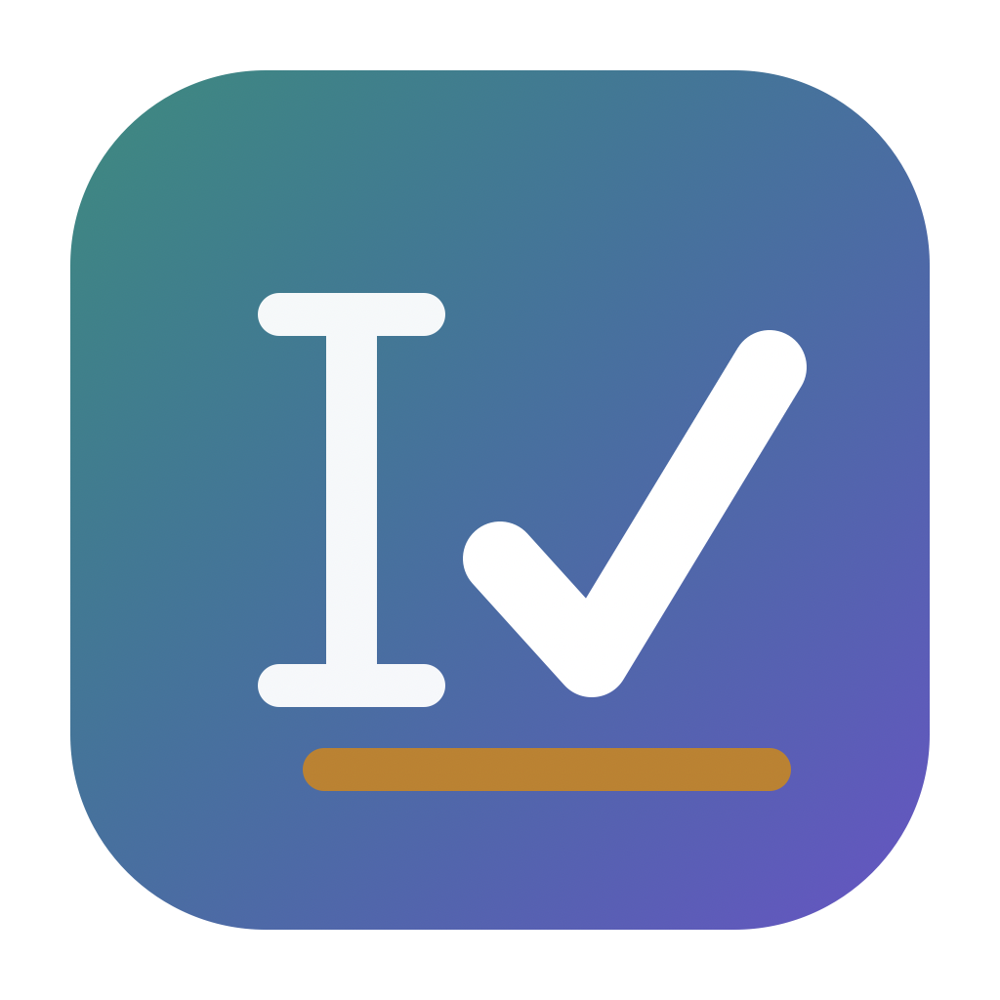
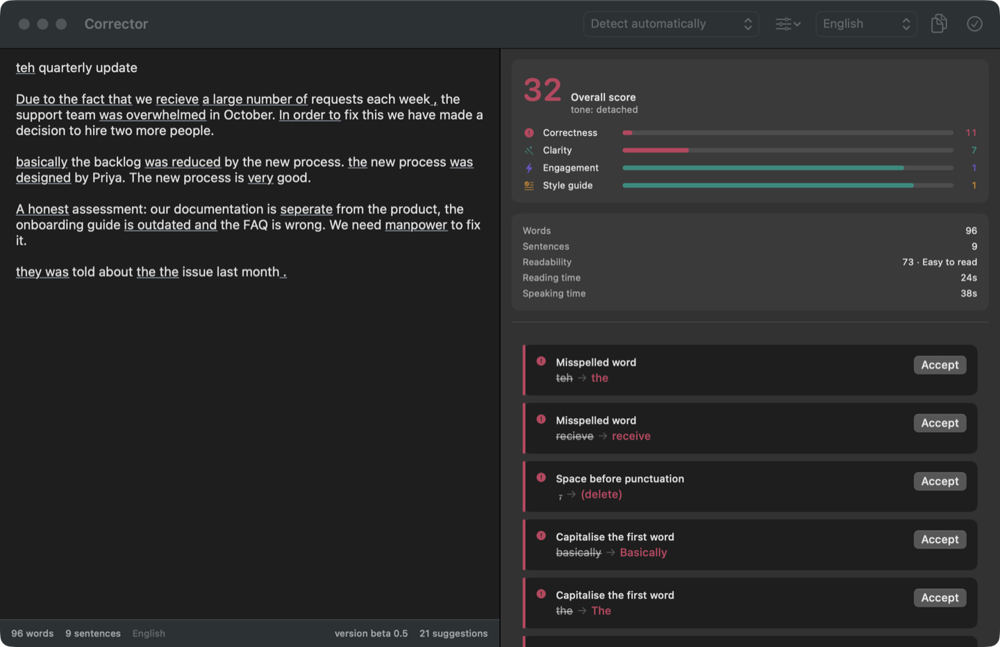
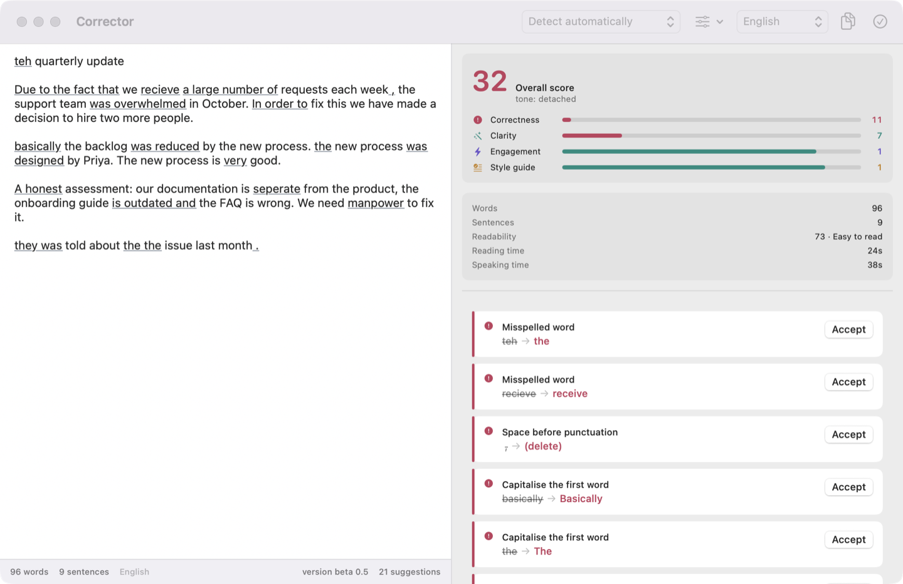
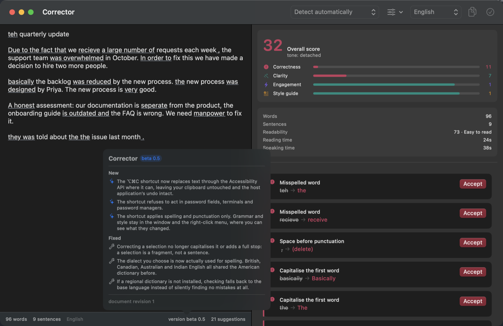

<div align="center">
  
  <h1>Corrector</h1>
  <p><b>Proofreading that never leaves your Mac.</b></p>
  <p>
    
    
    
    
    
    <a href="LICENSE"></a>
  </p>
</div>

Corrector checks spelling, grammar, punctuation, typography, clarity and tone —
in **English and French** — and corrects the text you selected in whatever
application you happen to be in. Every suggestion is computed on your machine by
rules you can read. There is no account, no sign-in, no telemetry, and no
network code anywhere in the project.

> [!NOTE]
> Corrector is in **beta 0.5**. There is no notarised release yet, so it is
> built from source — one command, no dependencies to fetch.

<div align="center">
  
</div>

---

## Install

```bash
git clone https://github.com/pedrolastiko/Corrector.git
cd Corrector
./Tools/make-app.sh
open dist/Corrector.app
```

`make-app.sh` assembles a real `.app` bundle — Services, menu-bar item, CLI
inside — in about ten seconds. Requires macOS 13 or later and Xcode 16 or later.
Nothing is downloaded; the package has no external dependencies.

## Permissions

| What | Needs | Why |
| --- | --- | --- |
| The window | nothing | your document, your machine |
| Right-click → **Services** | nothing | macOS hands over the selection because you asked |
| **⌥⌘C** anywhere | Accessibility | to read the selection and write the correction back |

Corrector asks for Accessibility only when you first press ⌥⌘C, and says so
rather than failing silently.

## Three ways to use it

### The window

Type or paste. Suggestions are underlined in their category colour and listed as
cards on the right — accept one, dismiss it, mute the rule, or add the word to
your dictionary. The score and the readability statistics update as you go.

### Right-click → Services

Select text in any application, right-click, and pick **Corriger la sélection**
to replace it in place, or **Ouvrir dans Corrector** to review it card by card.
This needs **no permission at all** — the system passes the selection over
because you asked it to.

> macOS reads these titles once, when the app registers, so they cannot follow
> the in-app interface picker. They are French in every language for now.

### ⌥⌘C, anywhere

Select, press, done. Corrector replaces the text through the Accessibility API
where the application allows it, so the change lands in that application's own
undo stack and your clipboard is never touched. Where it does not, it falls back
to a clipboard round trip, which works everywhere.

The shortcut applies **spelling and punctuation only**. It acts on text you are
not watching, in a document it cannot show you, so it sticks to the rules that
cannot be a matter of opinion. Grammar and style stay in the window and in the
Services menu, where you can see what changed.

## Features

**Checks**
- [x] Spelling, with the system dictionaries and your own additions
- [x] Grammar: article and subject-verb agreement, repeated words, sentence capitalisation
- [x] Punctuation and typography, including full French spacing and quotation marks
- [x] Clarity: wordiness, passive voice, nominalisation, long sentences
- [x] Engagement, style guide and inclusive language
- [x] Readability, reading time and speaking time
- [x] 14 rule plugins — seven per language — each one switchable on its own

**Languages**
- [x] English: American, British, Canadian, Australian, Indian
- [x] French: France, Canada, Belgium, Switzerland — with elision, *si* +
      conditional, *malgré que*, *pallier à*, narrow no-break spaces and « quotes »
- [x] Automatic detection per document
- [x] Interface in English or French, chosen independently of the text

**Safety**
- [x] Never reads password fields, by role *and* by subrole
- [x] Refuses to act in terminals, keychains and password managers
- [x] No event tap, no polling, no background reading of other applications
- [ ] A settings pane for the application denylist *(currently `defaults write`)*

**Planned**
- [ ] Incremental checking instead of re-checking the whole document
- [ ] A personal-dictionary and muted-rule manager
- [ ] A notarised, signed release and a Homebrew cask
- [ ] Services menu titles that follow the interface language

## Privacy

Corrector contains no networking code. Not disabled, not opt-out — absent. It
holds no account, collects nothing, and sends nothing anywhere.

⌥⌘C reads `AXFocusedUIElement` and `AXSelectedText` **once, from one element, in
response to a keystroke you pressed**: to decide whether the field is safe to
touch, and to replace what you selected. It installs no event tap, polls
nothing, reads no field you did not select, and runs no code between keystrokes.
A question asked once and answered once.

## Gallery

#### Light and dark, from the same tokens



#### What changed, in the footer



## Also a command-line tool

The app and the terminal share every module, so anything the engine can do is
scriptable.

```bash
swift run corrector check memo --cards     # review a document
swift run corrector fix draft.txt          # apply every suggestion
swift run corrector stats draft.txt        # readability only
swift run corrector check draft.txt --json # for machines
```

## Under the hood

Five libraries and two executables in one Swift package. Every layer below the
app builds and runs without a window, which is why a rule can be written and
asserted on before any view exists.

| Module | What it holds |
| --- | --- |
| `CorrectorDelta` | Quill-Delta operational transform over UTF-16 offsets |
| `CorrectorCore` | alerts, card layout, scores, statistics, design tokens |
| `CorrectorEngine` | the rules — 14 plugins, each separately testable |
| `CorrectorSession` | handshake, capability negotiation, alert rebasing |
| `CorrectorAppCore` | the app logic that is not a view, so it can be tested |
| `CorrectorApp` | the SwiftUI app, Services and the global shortcut |

Suggestions are **rebased, not recomputed**: each one is stamped with the
revision it was computed against and transformed onto the current text through
the intervening changesets. That is what stops cards flickering and jumping
while you type.

Full documentation in [`DOCUMENTATION.md`](DOCUMENTATION.md), release history
in [`CHANGELOG.md`](CHANGELOG.md).

```bash
swift test    # 257 tests across 5 targets
```

## Licence

MIT — see [`LICENSE`](LICENSE).
